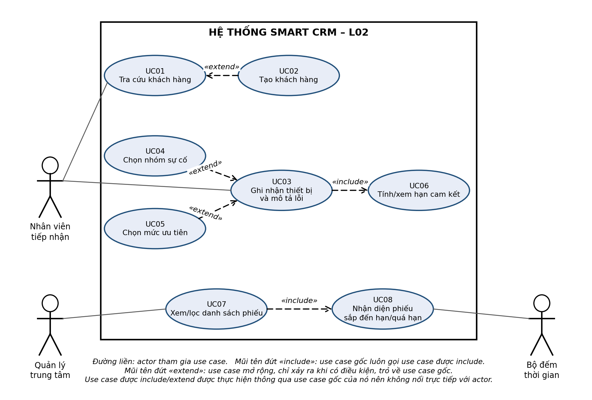
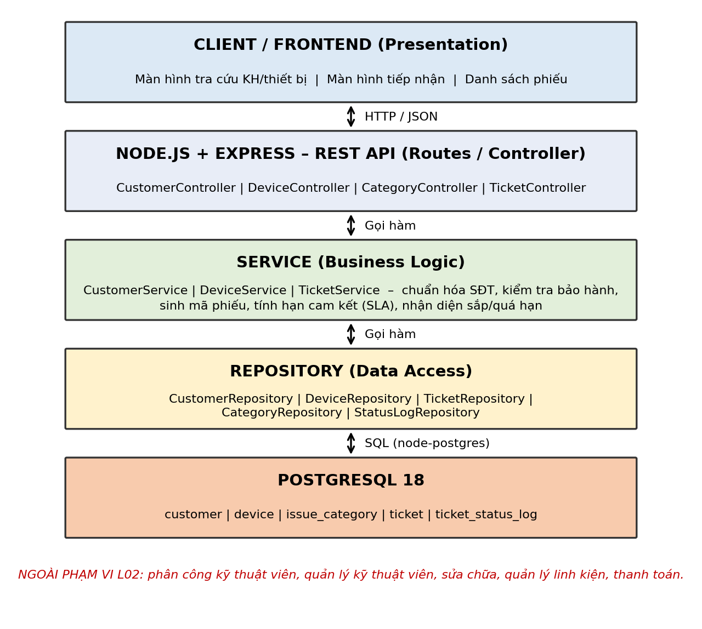
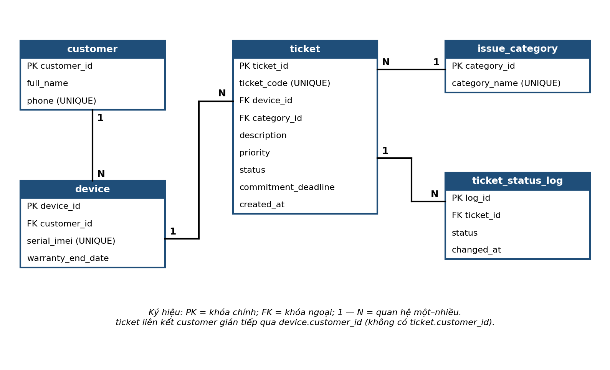

# TRƯỜNG ĐẠI HỌC VĂN LANG
# KHOA CÔNG NGHỆ THÔNG TIN

## BÁO CÁO CHUYÊN ĐỀ TỐT NGHIỆP 1

**Ngành:** Công nghệ thông tin  
**Chuyên ngành:** SE – Kỹ thuật phần mềm

# SRS — L02: TIẾP NHẬN VÀ PHÂN LOẠI BẢO HÀNH

**Sinh viên thực hiện:** Bùi Hoàng Khang  
**MSSV:** 2374802010207  
**GitHub Repository:** https://github.com/HoangKhanggggg/smartcrm-2374802010207-warranty-claim-intake  
**Giảng viên hướng dẫn:** ThS. Nguyễn Minh Tân

**TP. Hồ Chí Minh – năm 2026**

---

# MỤC LỤC

**Mục 1. BẢN SRS RÚT GỌN**

1.1 Giới thiệu  
1.2 Phạm vi của L02  
1.3 Bảng thuật ngữ  
1.4 Các bên liên quan và vai trò người dùng  
1.5 User Story và tiêu chí chấp nhận  
1.6 Yêu cầu chức năng (FR)  
1.7 Yêu cầu phi chức năng (NFR)  
1.8 Ràng buộc và quy tắc nghiệp vụ  
1.9 Bảng truy vết yêu cầu (FR ↔ US ↔ UC ↔ MoSCoW)

**Mục 2. USE CASE**

2.1 Use Case Diagram  
2.2 Danh sách Use Case  
2.3 Đặc tả chi tiết Use Case quan trọng nhất

**Mục 3. THIẾT KẾ KIẾN TRÚC**

3.1 Sơ đồ kiến trúc  
3.2 Chú thích kiến trúc  
3.3 Ba câu lập luận NFR

**Mục 4. MÔ HÌNH DỮ LIỆU – ERD VÀ SQL DDL**

4.1 Xác định bảng dữ liệu  
4.2 Quan hệ giữa các bảng (ERD)  
4.3 SQL DDL (PostgreSQL 18)

**Mục 5. WIREFRAME**

**PHỤ LỤC. BẢNG KHAI BÁO SỬ DỤNG CÔNG CỤ AI**

---

# MỤC 1. BẢN SRS RÚT GỌN

## 1.1 Giới thiệu

Luồng L02 – Tiếp nhận và phân loại yêu cầu bảo hành thuộc hệ thống Smart CRM của Mekong Mobile. Hệ thống hỗ trợ nhân viên tiếp nhận ghi nhận khách hàng, thiết bị và yêu cầu bảo hành; lưu thông tin theo mã phiếu duy nhất; hỗ trợ phân loại nhóm sự cố, chọn mức ưu tiên và tính hạn cam kết.

Luồng nghiệp vụ của L02: Tiếp nhận → ghi nhận khách hàng → ghi nhận thiết bị → ghi nhận lỗi → phân loại sự cố → chọn mức ưu tiên → tính hạn cam kết → quản lý danh sách phiếu.

## 1.2 Phạm vi của L02

**Trong phạm vi (IN SCOPE)**

- Tra cứu khách hàng bằng số điện thoại; tạo khách hàng mới nếu chưa có.
- Ghi nhận thiết bị bằng serial/IMEI; kiểm tra tình trạng bảo hành dựa trên `warranty_end_date`.
- Nhập mô tả lỗi; tạo phiếu bảo hành với mã phiếu duy nhất; ghi lịch sử trạng thái đầu tiên.
- Chọn nhóm sự cố, chọn mức ưu tiên; tự động tính hạn cam kết.
- Xem và lọc danh sách phiếu; nhận diện phiếu sắp đến hạn/quá hạn.

**NGOÀI PHẠM VI / WON'T trong L02**

- Phân công kỹ thuật viên; quản lý kỹ thuật viên.
- Xử lý sửa chữa thực tế; quản lý linh kiện.
- Thanh toán và hoàn tất sửa chữa ở mức nghiệp vụ đầy đủ.
- Lưu bản ghi phê duyệt chi tiết của quản lý.
- Phân quyền theo từng trung tâm/đơn vị ở mức mở rộng (để mở rộng sau).

## 1.3 Bảng thuật ngữ

Bảng thuật ngữ gồm cả từ viết tắt và thuật ngữ nghiệp vụ, dùng thống nhất giữa SRS, Use Case, ERD, DDL và Wireframe.

**a) Từ viết tắt**

| Thuật ngữ | Ý nghĩa |
|---|---|
| CRM | Customer Relationship Management – hệ thống quản lý quan hệ khách hàng. |
| L02 | Luồng tiếp nhận và phân loại yêu cầu bảo hành. |
| SRS | Software Requirements Specification – tài liệu đặc tả yêu cầu phần mềm. |
| US | User Story – câu chuyện người dùng. |
| FR | Functional Requirement – yêu cầu chức năng. |
| NFR | Non-functional Requirement – yêu cầu phi chức năng. |
| UC | Use Case – trường hợp sử dụng. |
| MoSCoW | Phương pháp phân loại mức độ ưu tiên của yêu cầu/User Story: MUST, SHOULD, COULD, WON'T. |
| PK / FK | Primary Key / Foreign Key – khóa chính / khóa ngoại. |
| ERD | Entity Relationship Diagram – sơ đồ thực thể liên kết dữ liệu. |
| DDL | Data Definition Language – các câu lệnh định nghĩa cấu trúc cơ sở dữ liệu. |
| IMEI | International Mobile Equipment Identity – mã định danh quốc tế của thiết bị di động. |

**b) Thuật ngữ nghiệp vụ**

| Thuật ngữ | Ý nghĩa nghiệp vụ |
|---|---|
| Ticket / Phiếu bảo hành | Hồ sơ điện tử đại diện cho một yêu cầu bảo hành, có mã phiếu duy nhất (`ticket_code`). |
| Serial/IMEI | Mã định danh duy nhất của thiết bị; một thiết bị chỉ thuộc một khách hàng tại một thời điểm. |
| Tình trạng bảo hành | Kết quả hệ thống tính từ `warranty_end_date`: Còn bảo hành, Hết bảo hành hoặc Chưa xác minh bảo hành (khi `warranty_end_date` rỗng). |
| SLA / Hạn cam kết | Mốc thời gian hệ thống tự tính để cam kết xử lý phiếu, theo mức ưu tiên (Cao 24 giờ, Trung bình 72 giờ, Thấp 120 giờ); không cho sửa tay. |
| Mức ưu tiên (ticket) | Mức độ khẩn cấp của phiếu: Cao, Trung bình hoặc Thấp. Khác với MoSCoW (mức ưu tiên của User Story). |
| Nhóm sự cố | Danh mục dùng để phân loại sự cố: Màn hình, Pin, Sạc, Phần mềm, Nước vào, Khác. |
| Trạng thái | Bước trong vòng đời xử lý phiếu: Mới → Đã phân công → Đang xử lý → Chờ linh kiện → Hoàn tất → Đã đóng. |
| Lịch sử trạng thái | Các dòng ghi lại trạng thái của phiếu theo thời điểm, lưu ở bảng `ticket_status_log`. |
| Sắp đến hạn | Phiếu còn ≤ 8 giờ so với hạn cam kết và chưa Hoàn tất/Đã đóng. |
| Quá hạn | Phiếu có thời điểm hiện tại > hạn cam kết và chưa Hoàn tất/Đã đóng. |
| Chuẩn hóa số điện thoại | Đưa số điện thoại về 10 chữ số, bắt đầu bằng 0 (xử lý +84, 84, dấu cách, dấu chấm). |
| Xóa mềm | Đánh dấu không còn sử dụng thay vì xóa vật lý (định hướng mở rộng, chưa có cột trong DDL L02). |
| WON'T | Chức năng được xác nhận không làm trong L02 (xem mục 1.2). |

## 1.4 Các bên liên quan và vai trò người dùng

| Actor | Vai trò |
|---|---|
| Nhân viên tiếp nhận | Tra cứu khách hàng; tạo hồ sơ; ghi nhận thiết bị; tạo phiếu; phân loại; chọn ưu tiên. |
| Quản lý trung tâm | Theo dõi danh sách phiếu, lọc theo điều kiện, theo dõi phiếu sắp/quá hạn; xem xét các trường hợp chưa xác minh bảo hành theo quy định (L02 chỉ hiển thị trạng thái, chưa lưu bản ghi phê duyệt). |
| Bộ đếm thời gian | Kích hoạt kiểm tra định kỳ để xác định phiếu sắp hoặc quá hạn cam kết. |

## 1.5 User Story và tiêu chí chấp nhận

Có 7 User Story. MoSCoW là mức ưu tiên của User Story, không phải mức ưu tiên của phiếu (Cao/Trung bình/Thấp).

| Mã | User Story rút gọn | Actor | MoSCoW |
|---|---|---|---|
| US01 | Tra cứu khách hàng bằng số điện thoại và tạo hồ sơ mới nếu chưa có. | Nhân viên | MUST |
| US02 | Ghi nhận thiết bị bằng serial/IMEI và kiểm tra tình trạng bảo hành. | Nhân viên | MUST |
| US03 | Ghi mô tả lỗi và tạo phiếu bảo hành có mã duy nhất. | Nhân viên | MUST |
| US04 | Chọn nhóm sự cố từ danh mục cố định. | Nhân viên | SHOULD |
| US05 | Chọn mức ưu tiên Cao/Trung bình/Thấp. | Nhân viên | SHOULD |
| US06 | Xem hạn cam kết do hệ thống tính theo mức ưu tiên. | Nhân viên | SHOULD |
| US07 | Xem danh sách phiếu theo trạng thái, nhóm sự cố và mức ưu tiên. | Quản lý | MUST |

**Tiêu chí chấp nhận (Given – When – Then)**

| Mã AC | Nội dung |
|---|---|
| US01 – AC1 | Given khách có số điện thoại đã tồn tại. When nhân viên nhập số điện thoại hợp lệ và tìm kiếm. Then hệ thống chuẩn hóa về 10 chữ số, hiển thị hồ sơ đã có và không tạo bản ghi mới. |
| US01 – AC2 | Given số điện thoại hợp lệ chưa tồn tại. When nhân viên chọn tạo khách hàng mới, nhập họ tên và lưu. Then hệ thống tạo `customer` mới và gắn khách vào phiếu đang lập. |
| US01 – AC3 | Given chuỗi nhập chứa chữ cái hoặc sau chuẩn hóa không đủ 10 chữ số bắt đầu bằng 0. When tìm kiếm. Then hệ thống báo số điện thoại không hợp lệ và không thực hiện tìm kiếm. |
| US02 – AC1 | Given thiết bị có serial/IMEI hợp lệ. When nhân viên tra cứu/lưu thiết bị. Then hệ thống xác định tình trạng bảo hành dựa trên `warranty_end_date`: còn hạn hoặc hết hạn. |
| US02 – AC2 | Given không xác định được dữ liệu hạn bảo hành. When nhân viên tiếp tục. Then hệ thống hiển thị "Chưa xác minh bảo hành" (khi `warranty_end_date` rỗng) và quản lý xem xét trường hợp này theo quy định; nhân viên không tự chọn "Còn bảo hành". |
| US02 – AC3 | Given serial/IMEI đã thuộc thiết bị khác. When lưu. Then hệ thống từ chối, báo lỗi và giữ dữ liệu đã nhập. |
| US03 – AC1 | Given khách và thiết bị đã xác định. When nhập mô tả lỗi và tạo phiếu. Then hệ thống sinh mã duy nhất, trạng thái Mới, ưu tiên mặc định Trung bình, tính hạn cam kết và ghi lịch sử trạng thái đầu tiên. |
| US03 – AC2 | Given thiếu mô tả lỗi hoặc chưa có thiết bị. When tạo phiếu. Then hệ thống không lưu và đánh dấu trường thiếu. |
| US03 – AC3 | Given dữ liệu hợp lệ. When lưu thất bại. Then hệ thống báo lỗi, giữ dữ liệu form và không tạo bản ghi dang dở. |
| US04 – AC1 | Given nhân viên đang lập phiếu. When mở nhóm sự cố. Then hệ thống hiển thị danh mục đang sử dụng: Màn hình, Pin, Sạc, Phần mềm, Nước vào, Khác. |
| US04 – AC2 | Given chưa chọn nhóm sự cố. When tạo phiếu. Then hệ thống cho phép lưu `category_id` rỗng và nhắc bổ sung sau. |
| US05 – AC1 | Given nhân viên chọn mức ưu tiên. Then chỉ có Cao, Trung bình, Thấp. |
| US05 – AC2 | Given đang lập phiếu. Then mức ưu tiên được chọn sẵn là Trung bình (giá trị mặc định của `ticket.priority`); nhân viên được phép đổi sang Cao hoặc Thấp. |
| US06 – AC1 | Given nhân viên chọn/đổi ưu tiên. Then hệ thống tính hạn cam kết ngay theo 24/72/120 giờ tương ứng Cao/Trung bình/Thấp và không cho sửa tay. |
| US06 – AC2 | Given phiếu lúc 10:00 Thứ Bảy, ưu tiên Cao 24 giờ. Then hạn là 10:00 Thứ Hai vì Chủ nhật là ngày nghỉ theo quy tắc L02. |
| US07 – AC1 | Given quản lý mở danh sách. Then hệ thống hiển thị 20 phiếu/trang với mã phiếu, khách hàng, thiết bị, trạng thái, nhóm sự cố, ưu tiên, hạn cam kết và ngày tiếp nhận. |
| US07 – AC2 | Given quản lý chọn nhiều bộ lọc. Then hệ thống chỉ hiển thị phiếu thỏa tất cả điều kiện. |
| US07 – AC3 | Given không có phiếu phù hợp. Then hiển thị "Không có phiếu phù hợp". |

## 1.6 Yêu cầu chức năng (FR)

| Mã | Yêu cầu chức năng | US |
|---|---|---|
| FR01 | Tra cứu khách hàng bằng số điện thoại và hiển thị kết quả phù hợp. | US01 |
| FR02 | Tạo hồ sơ khách hàng mới khi chưa có hồ sơ phù hợp. | US01 |
| FR03 | Ghi nhận hoặc tra cứu thiết bị bằng serial/IMEI. | US02 |
| FR04 | Hiển thị tình trạng bảo hành dựa trên `warranty_end_date`. | US02 |
| FR05 | Nhập và lưu mô tả lỗi của thiết bị. | US03 |
| FR06 | Tạo mã phiếu bảo hành duy nhất khi tạo phiếu thành công. | US03 |
| FR07 | Cung cấp danh mục nhóm sự cố để nhân viên lựa chọn. | US04 |
| FR08 | Cho phép chọn một trong ba mức ưu tiên Cao, Trung bình, Thấp. | US05 |
| FR09 | Tính và hiển thị hạn cam kết theo quy tắc đã cấu hình. | US06 |
| FR10 | Cho phép quản lý xem và lọc danh sách phiếu. | US07 |
| FR11 | Nhận diện phiếu sắp đến hạn hoặc đã quá hạn theo QT-13. | US07 |

## 1.7 Yêu cầu phi chức năng (NFR)

| Mã | Nhóm | Yêu cầu | Tiêu chí đo lường | Cách kiểm tra |
|---|---|---|---|---|
| NFR01 | Hiệu năng | Tra cứu khách hàng/thiết bị phản hồi nhanh. | 95% thao tác phản hồi ≤ 2 giây với 50 người dùng đồng thời. | Kiểm thử tải. |
| NFR02 | Tính toàn vẹn dữ liệu | Phiếu tạo ra phải hợp lệ. | 100% phiếu tạo thành công có mã duy nhất; không lưu phiếu thiếu trường bắt buộc. | Kiểm thử ràng buộc và dữ liệu. |
| NFR03 | Bảo mật | API kiểm tra quyền theo vai trò. | 100% API tạo/xem phiếu kiểm tra quyền theo vai trò. | Truy cập bằng tài khoản không đủ quyền. |
| NFR04 | Khả năng sử dụng | Quy trình tạo phiếu dễ dùng. | Người dùng thử nghiệm hoàn thành quy trình tạo phiếu trong tối đa 3 phút sau hướng dẫn ngắn. | Kiểm thử usability theo kịch bản. |

## 1.8 Ràng buộc và quy tắc nghiệp vụ

| Mã | Quy tắc | Áp dụng |
|---|---|---|
| QT-01 | Số điện thoại duy nhất; nhập số đã có thì hiển thị hồ sơ cũ. | FR02 |
| QT-02 | Chuẩn hóa số điện thoại về 10 chữ số bắt đầu bằng 0; xử lý +84, 84, dấu cách, dấu chấm. | FR01 |
| QT-03 | Thiết bị xác định duy nhất bằng serial/IMEI; chỉ thuộc một khách tại một thời điểm. | FR03 |
| QT-04 | Hạn cam kết theo SLA: Cao 24h, Trung bình 72h, Thấp 120h. Khi thời hạn rơi vào Chủ nhật thì chuyển sang cùng giờ ngày Thứ Hai. | FR09 |
| QT-05 | Không xác định được hạn bảo hành (`warranty_end_date` rỗng) thì hiển thị "Chưa xác minh bảo hành" và chuyển quản lý xem xét; nhân viên không tự chọn "Còn bảo hành". | FR04 |
| QT-06 | Vòng đời trạng thái: Mới → Đã phân công → Đang xử lý → Chờ linh kiện → Hoàn tất → Đã đóng. Mọi thay đổi ghi vào `ticket_status_log`. | FR06, FR10, FR11 |
| QT-07 | `ticket` liên kết khách hàng gián tiếp qua `device.customer_id`; không tạo `ticket.customer_id` để tránh dư thừa dữ liệu. | FR03, FR05, FR06 |
| QT-08 | `priority` chỉ nhận Cao, Trung bình, Thấp. | FR08 |
| QT-09 | `category_id` có thể rỗng khi phiếu chưa được phân loại. | FR07 |
| QT-10 | Không xóa vật lý phiếu, thiết bị và hồ sơ; dùng cơ chế xóa mềm khi cần mở rộng. | Toàn bộ |
| QT-11 | Phân quyền theo vai trò, kiểm tra tại server: nhân viên tiếp nhận được tạo phiếu và tra cứu; quản lý được xem, lọc danh sách và phiếu sắp/quá hạn. | FR10, FR11 |
| QT-12 | Số điện thoại hiển thị dạng che với vai trò không được cấp quyền xem đầy đủ. | FR01, FR10 |
| QT-13 | Phiếu sắp đến hạn: còn ≤ 8 giờ so với `commitment_deadline` và `status` chưa là Hoàn tất/Đã đóng. Phiếu quá hạn: thời điểm hiện tại > `commitment_deadline` và `status` chưa là Hoàn tất/Đã đóng. Ngưỡng 8 giờ là giá trị cấu hình. | FR11 |

## 1.9 Bảng truy vết yêu cầu (FR ↔ US ↔ UC ↔ MoSCoW)

| FR | US | UC | MoSCoW |
|---|---|---|---|
| FR01 | US01 | UC01 | MUST |
| FR02 | US01 | UC02 | MUST |
| FR03 | US02 | UC03 | MUST |
| FR04 | US02 | UC03 | MUST |
| FR05 | US03 | UC03 | MUST |
| FR06 | US03 | UC03 | MUST |
| FR07 | US04 | UC04 | SHOULD |
| FR08 | US05 | UC05 | SHOULD |
| FR09 | US06 | UC06 | SHOULD |
| FR10 | US07 | UC07 | MUST |
| FR11 | US07 | UC08 | MUST |

Đối chiếu vấn đề hiện tại: V1 – hồ sơ khách trùng → US01; V2 – khó theo dõi trạng thái và phiếu quá hạn → US06/US07; V8 – mô tả lỗi tự do khó thống kê → US04.

---

# MỤC 2. USE CASE

## 2.1 Use Case Diagram



*Hình 2.1 – Use Case Diagram của L02 (file gốc: `usecase.drawio`)*

**Chú thích ký hiệu**

- Hình chữ nhật lớn: ranh giới hệ thống Smart CRM – L02.
- Hình người (actor): người dùng hoặc tác nhân bên ngoài hệ thống (Nhân viên tiếp nhận, Quản lý trung tâm, Bộ đếm thời gian).
- Hình elip: một use case (chức năng của hệ thống).
- Đường liền: actor tham gia use case.
- Mũi tên đứt «include»: use case gốc luôn gọi use case được include; mũi tên trỏ từ use case gốc đến use case được include.
- Mũi tên đứt «extend»: use case mở rộng, chỉ xảy ra khi có điều kiện; mũi tên trỏ từ use case mở rộng về use case gốc.
- Use case được include/extend được thực hiện thông qua use case gốc nên không nối trực tiếp với actor.

**Giải thích các quan hệ trong sơ đồ**

- UC02 «extend» UC01: chỉ tạo khách hàng khi số điện thoại chưa có hồ sơ.
- UC04 «extend» UC03: chọn nhóm sự cố là tùy chọn, `category_id` có thể rỗng.
- UC05 «extend» UC03: chọn mức ưu tiên là tùy chọn, mặc định là Trung bình.
- UC03 «include» UC06: tạo phiếu nào cũng phải tính hạn cam kết.
- UC07 «include» UC08: danh sách phiếu luôn đánh dấu phiếu sắp đến hạn/quá hạn.

## 2.2 Danh sách Use Case

| Mã | Tên Use Case | Actor | US |
|---|---|---|---|
| UC01 | Tra cứu khách hàng | Nhân viên tiếp nhận | US01 |
| UC02 | Tạo khách hàng | Nhân viên tiếp nhận | US01 |
| UC03 | Ghi nhận thiết bị và mô tả lỗi | Nhân viên tiếp nhận | US02, US03 |
| UC04 | Chọn nhóm sự cố | Nhân viên tiếp nhận | US04 |
| UC05 | Chọn mức ưu tiên | Nhân viên tiếp nhận | US05 |
| UC06 | Tính/xem hạn cam kết | Nhân viên tiếp nhận | US06 |
| UC07 | Xem/lọc danh sách phiếu | Quản lý trung tâm | US07 |
| UC08 | Nhận diện phiếu sắp/quá hạn | Quản lý trung tâm, Bộ đếm thời gian | US07 |

## 2.3 Đặc tả chi tiết Use Case quan trọng nhất

| Thuộc tính | Nội dung |
|---|---|
| Tên Use Case | UC03 – Ghi nhận thiết bị và mô tả lỗi |
| Actor | Nhân viên tiếp nhận |
| Tiền điều kiện | Đã đăng nhập; khách hàng được xác định; thiết bị có serial/IMEI hợp lệ. |
| Hậu điều kiện | Phiếu được lưu thành công, có mã duy nhất, liên kết với device và category nếu có; hạn cam kết được ghi nhận nếu đủ dữ liệu; trạng thái đầu tiên được ghi vào `ticket_status_log`. |

**Luồng chính**

1. Nhân viên mở chức năng tạo phiếu.
2. Hệ thống hiển thị khách hàng và thiết bị đã xác định.
3. Nhân viên nhập mô tả lỗi.
4. Nhân viên chọn nhóm sự cố và mức ưu tiên.
5. Hệ thống kiểm tra trường bắt buộc.
6. Hệ thống sinh mã phiếu và tính hạn cam kết.
7. Hệ thống lưu `ticket` và ghi dòng trạng thái đầu tiên (`ticket_status_log`).
8. Hệ thống thông báo tạo phiếu thành công.

**Luồng ngoại lệ (đánh theo bước)**

- **5a.** Thiếu mô tả lỗi hoặc thiết bị: hệ thống báo trường cần bổ sung, không lưu.
- **6a.** Không tính được hạn cam kết: hệ thống báo lỗi cấu hình, không tạo phiếu thành công.
- **7a.** Lỗi kết nối/cơ sở dữ liệu: hệ thống báo chưa lưu được, giữ dữ liệu form và không tạo bản ghi dang dở.

---

# MỤC 3. THIẾT KẾ KIẾN TRÚC

## 3.1 Sơ đồ kiến trúc



*Hình 3.1 – Kiến trúc Controller → Service → Repository → PostgreSQL 18 (file gốc: `architecture.drawio`)*

## 3.2 Chú thích kiến trúc

| Thành phần | Trách nhiệm | Ví dụ |
|---|---|---|
| Client / Frontend | Nhận thao tác và hiển thị kết quả. | Màn hình tra cứu, tiếp nhận, danh sách phiếu. |
| Controller (Express) | Nhận HTTP request, trả HTTP response, kiểm tra quyền theo vai trò. | GET/POST `/api/customers`, `/api/devices`; POST/GET `/api/tickets`. |
| Service | Thực hiện quy tắc nghiệp vụ của L02. | Chuẩn hóa số điện thoại, kiểm tra bảo hành, sinh mã phiếu, tính hạn cam kết, nhận diện sắp/quá hạn. |
| Repository | Đọc/ghi dữ liệu PostgreSQL: SELECT, INSERT, UPDATE, JOIN, lọc, transaction khi cần. | CustomerRepository, DeviceRepository, TicketRepository, CategoryRepository, StatusLogRepository. |
| Database | Lưu dữ liệu bền vững (PostgreSQL 18). | 5 bảng: `customer`, `device`, `issue_category`, `ticket`, `ticket_status_log`. |

Mũi tên hai chiều trong sơ đồ: luồng gọi và dữ liệu trả về giữa hai lớp liền kề.

Ngoài phạm vi L02: phân công kỹ thuật viên, sửa chữa, quản lý linh kiện, thanh toán – không có AssignService hay TechnicianRepository trong kiến trúc này.

## 3.3 Ba câu lập luận NFR

**Lập luận 1 – Hiệu năng:** NFR01 yêu cầu 95% tra cứu ≤ 2 giây với 50 người dùng. Vì vậy `customer.phone` và `device.serial_imei` dùng ràng buộc UNIQUE (tự tạo index) và thêm index `ticket(status, commitment_deadline)` cho lọc danh sách và nhận diện quá hạn; đánh đổi là tăng dung lượng index và chi phí cập nhật.

**Lập luận 2 – Tính toàn vẹn:** NFR02 yêu cầu mã phiếu duy nhất và dữ liệu bắt buộc. Vì vậy dùng UNIQUE, NOT NULL, CHECK và FK, cùng transaction khi tạo ticket và status log; đánh đổi là dữ liệu không hợp lệ sẽ bị từ chối và giao diện phải thông báo rõ.

**Lập luận 3 – Bảo mật:** NFR03 yêu cầu kiểm tra quyền theo vai trò ở API. Vì vậy xác thực và phân quyền được thực hiện ở server (lớp Controller) trước khi xử lý yêu cầu; đánh đổi là cần thêm cấu hình và kiểm thử.

---

# MỤC 4. MÔ HÌNH DỮ LIỆU – ERD VÀ SQL DDL

## 4.1 Xác định bảng dữ liệu

| Bảng | Mục đích | Cột đúng theo DDL |
|---|---|---|
| `customer` | Lưu khách hàng. | `customer_id`, `full_name`, `phone` |
| `device` | Lưu thiết bị của khách hàng. | `device_id`, `customer_id`, `serial_imei`, `warranty_end_date` |
| `issue_category` | Danh mục nhóm sự cố. | `category_id`, `category_name` |
| `ticket` | Lưu phiếu bảo hành. | `ticket_id`, `ticket_code`, `device_id`, `category_id`, `description`, `priority`, `status`, `commitment_deadline`, `created_at` |
| `ticket_status_log` | Lưu lịch sử trạng thái. | `log_id`, `ticket_id`, `status`, `changed_at` |

## 4.2 Quan hệ giữa các bảng (ERD)



*Hình 4.1 – ERD của L02 (chỉ gồm các cột có trong DDL; file gốc: `erd.drawio`)*

**Chú thích ký hiệu:** PK = khóa chính; FK = khóa ngoại; 1 — N = quan hệ một–nhiều (phía 1 là bảng cha, phía N là bảng con).

| Quan hệ | Ý nghĩa |
|---|---|
| `customer` 1 — N `device` | Một khách hàng có nhiều thiết bị; mỗi thiết bị thuộc một khách hàng. |
| `device` 1 — N `ticket` | Một thiết bị có thể có nhiều phiếu bảo hành. |
| `issue_category` 1 — N `ticket` | Một nhóm sự cố gắn với nhiều phiếu; `category_id` có thể rỗng. |
| `ticket` 1 — N `ticket_status_log` | Một phiếu có nhiều dòng lịch sử trạng thái. |

**Đồng bộ bắt buộc:** ERD chỉ chứa các cột có trong DDL; không có `customer.email`, `customer.segment` hoặc `ticket.customer_id`. Khách hàng liên kết với ticket thông qua `device.customer_id`.

## 4.3 SQL DDL (PostgreSQL 18)

Ghi chú: DDL là nguồn chuẩn cho ERD và Wireframe (file `db/schema.sql`). Các giá trị ưu tiên/trạng thái được thống nhất bằng tiếng Việt (Cao/Trung bình/Thấp; Mới/Đã phân công/...) để tránh lệch thuật ngữ với SRS.

```sql
CREATE TABLE customer (
  customer_id BIGINT GENERATED ALWAYS AS IDENTITY PRIMARY KEY,
  full_name VARCHAR(150) NOT NULL,
  phone VARCHAR(20) NOT NULL UNIQUE
);

CREATE TABLE device (
  device_id BIGINT GENERATED ALWAYS AS IDENTITY PRIMARY KEY,
  customer_id BIGINT NOT NULL,
  serial_imei VARCHAR(100) NOT NULL UNIQUE,
  warranty_end_date DATE,
  CONSTRAINT fk_device_customer
    FOREIGN KEY (customer_id) REFERENCES customer(customer_id)
);

CREATE TABLE issue_category (
  category_id BIGINT GENERATED ALWAYS AS IDENTITY PRIMARY KEY,
  category_name VARCHAR(100) NOT NULL UNIQUE
);

CREATE TABLE ticket (
  ticket_id BIGINT GENERATED ALWAYS AS IDENTITY PRIMARY KEY,
  ticket_code VARCHAR(50) NOT NULL UNIQUE,
  device_id BIGINT NOT NULL,
  category_id BIGINT,
  description TEXT NOT NULL,
  priority VARCHAR(20) NOT NULL DEFAULT 'Trung bình',
  status VARCHAR(30) NOT NULL DEFAULT 'Mới',
  commitment_deadline TIMESTAMP,
  created_at TIMESTAMP NOT NULL DEFAULT CURRENT_TIMESTAMP,
  CONSTRAINT fk_ticket_device
    FOREIGN KEY (device_id) REFERENCES device(device_id),
  CONSTRAINT fk_ticket_category
    FOREIGN KEY (category_id) REFERENCES issue_category(category_id),
  CONSTRAINT chk_ticket_priority
    CHECK (priority IN ('Cao', 'Trung bình', 'Thấp')),
  CONSTRAINT chk_ticket_status
    CHECK (status IN ('Mới','Đã phân công','Đang xử lý',
                      'Chờ linh kiện','Hoàn tất','Đã đóng'))
);

CREATE TABLE ticket_status_log (
  log_id BIGINT GENERATED ALWAYS AS IDENTITY PRIMARY KEY,
  ticket_id BIGINT NOT NULL,
  status VARCHAR(30) NOT NULL,
  changed_at TIMESTAMP NOT NULL DEFAULT CURRENT_TIMESTAMP,
  CONSTRAINT fk_status_log_ticket
    FOREIGN KEY (ticket_id) REFERENCES ticket(ticket_id),
  CONSTRAINT chk_status_log_status
    CHECK (status IN ('Mới','Đã phân công','Đang xử lý',
                      'Chờ linh kiện','Hoàn tất','Đã đóng'))
);

-- customer.phone và device.serial_imei đã có index từ ràng buộc UNIQUE
CREATE INDEX idx_ticket_status_deadline
  ON ticket(status, commitment_deadline);
```

---

# MỤC 5. WIREFRAME

Các màn hình chỉ dùng những trường có trong DDL; không hiển thị email, địa chỉ, ngày mua, nơi mua, segment hoặc `ticket.customer_id`.

**Màn hình 1 – Tra cứu khách hàng và thiết bị**

| Thành phần | Nội dung |
|---|---|
| Số điện thoại khách hàng | [ Nhập số điện thoại – chuẩn hóa về 10 chữ số ] |
| Kết quả khách hàng | Họ tên (`full_name`) + số điện thoại dạng che |
| Serial / IMEI | [ Nhập serial/IMEI thiết bị ] |
| Tình trạng bảo hành | Còn bảo hành / Hết bảo hành / Chưa xác minh bảo hành (tính từ `warranty_end_date`) |
| Nút | **[Tra cứu]** |

**Màn hình 2 – Tiếp nhận và phân loại yêu cầu**

| Thành phần | Nội dung |
|---|---|
| Khách hàng | Chọn từ kết quả tra cứu |
| Thiết bị | Chọn serial/IMEI đã xác định |
| Mô tả lỗi | [ Nhập nội dung khách mô tả ] (bắt buộc) |
| Nhóm sự cố | Màn hình / Pin / Sạc / Phần mềm / Nước vào / Khác (có thể để trống) |
| Mức ưu tiên | Cao / Trung bình / Thấp (mặc định: Trung bình) |
| Hạn cam kết | Hệ thống tự tính – chỉ đọc (read-only) |
| Nút | **[Tạo phiếu bảo hành]** |

**Màn hình 3 – Danh sách phiếu bảo hành**

| Thành phần | Nội dung |
|---|---|
| Bộ lọc trạng thái | Tất cả / Mới / Đã phân công / Đang xử lý / Chờ linh kiện / Hoàn tất / Đã đóng |
| Bộ lọc nhóm sự cố | Tất cả / các nhóm trong danh mục |
| Bộ lọc mức ưu tiên | Tất cả / Cao / Trung bình / Thấp |
| Danh sách (20 phiếu/trang) | Mã phiếu \| Khách hàng \| Thiết bị \| Trạng thái \| Nhóm sự cố \| Ưu tiên \| Hạn cam kết \| Ngày tiếp nhận |
| Cảnh báo hạn | Đánh dấu phiếu Sắp đến hạn / Quá hạn (QT-13) |
| Khi không có kết quả | Không có phiếu phù hợp |
| Nút | **[Lọc danh sách]** |

**Nguyên tắc đồng bộ Wireframe – DDL**

- `customer`: chỉ dùng `customer_id`, `full_name`, `phone`.
- `device`: chỉ dùng `device_id`, `customer_id`, `serial_imei`, `warranty_end_date`.
- `issue_category`: chỉ dùng `category_id`, `category_name`.
- `ticket`: chỉ dùng `ticket_id`, `ticket_code`, `device_id`, `category_id`, `description`, `priority`, `status`, `commitment_deadline`, `created_at`.
- Không hiển thị email, địa chỉ, ngày mua, nơi mua hoặc `ticket.customer_id` vì các trường này không có trong DDL chuẩn.

---

# PHỤ LỤC. BẢNG KHAI BÁO SỬ DỤNG CÔNG CỤ AI

| Công cụ | Dùng vào việc gì | Áp dụng phần nào | Đã kiểm chứng thế nào |
|---|---|---|---|
| Gemini (AI) | Hỗ trợ đề xuất skeleton DDL, rà soát câu lệnh và gợi ý cấu trúc. | Mục 4 – ERD & DDL | Đối chiếu thủ công ERD–DDL–yêu cầu; kiểm tra PK/FK, cột và ràng buộc. |
| Claude (AI) | Hỗ trợ rà soát nhất quán và dàn trang lại tài liệu theo nhận xét của giảng viên. | Toàn bộ tài liệu (định dạng, sơ đồ, chú thích) | Đối chiếu từng mục với DDL chuẩn và nhận xét của giảng viên. |

**Cam kết sử dụng AI:** Tôi chịu trách nhiệm kiểm tra, chỉnh sửa và xác nhận tính đúng đắn của nội dung trước khi nộp. Công cụ AI chỉ được sử dụng để hỗ trợ, không thay thế trách nhiệm của người thực hiện.

**Họ và tên:** Bùi Hoàng Khang  
**MSSV:** 2374802010207  
**Ngày:** 19/10/2026  
**Chữ ký:**
khang
